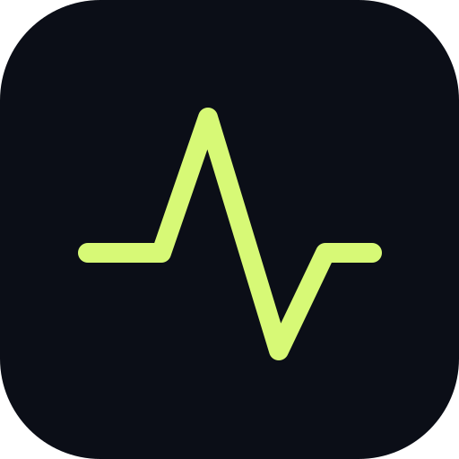

<div align="center">
  
  <h1>DevWell Pulse</h1>
  <p><strong>A little better, every day.</strong></p>
  <p>A personal wellness companion for screen-heavy workdays.</p>
  <p><a href="https://vignesh-s-github.github.io/DevWell/">🌐 Open the app</a> · <a href="#-getting-started">🚀 Run locally</a> · <a href="#-data-and-privacy">🔒 Data & privacy</a></p>
</div>

[](https://github.com/Vignesh-S-GitHub/DevWell/actions/workflows/pages.yml)

DevWell brings water, meals, movement, sleep, mood and healthy workday breaks into one responsive, installable web app. It works offline after setup and keeps personal logs in your browser. There are no accounts, analytics, paid APIs or cloud uploads.

**Current release: 3.7.0.** Built with plain HTML, CSS and JavaScript, with no runtime framework or production dependency.

## ✨ What you can do

| Screen | Features |
| --- | --- |
| **Today** | Daily routine progress, water/movement/meal/sleep snapshot, quick logging and mood check-in |
| **Routine** | 13 editable weekday windows, completion filters, recent dates and recurring calendar export |
| **Food** | Hydration goals, one-tap water entries, meal diary and South Indian meal ideas |
| **Move** | Movement goals, eye/walk/breathing timers and a six-step illustrated desk stretch |
| **Insights** | Actual routine, water, movement and sleep values over 7/14 days, mood and earlier-date review |
| **Preferences** | Goals, dark/light appearance, animations, vibration, notifications, installation, backup/restore and local-data reset |

Lunch remains one hour. Breakfast begins before the original 10 AM–7 PM workday routine; edit the windows to suit your day. Goals are personal preferences, and meal ideas are suggestions rather than nutritional prescriptions.

## 🎉 Goal celebrations

Reaching a water, movement or full-routine goal shows a short, themed achievement banner. It appears only when a log crosses the goal, once per category per stored day. Further entries, Undo/re-log, reloads and backup round-trips do not replay the same celebration. Editing a goal or opening old history does not trigger a celebration.

Celebrations use the existing Pulse palette and original icons. Reduced motion or the **Gentle animations** switch keeps the success message and removes the effects. Dismiss the banner at any time.

## ↩️ Undo after logging

A small **Undo** bar follows the last changed water, movement, meal, sleep, mood or routine entry, including meal removals and fresh movement credit from completed timers.

- Undo restores the affected field on its captured date; it does not restore an old copy of the entire database.
- The action is available for 10 seconds of available interaction time. Hovering, keyboard focus and a hidden document pause its expiration.
- A newer log replaces the previous Undo. Reloading, restoring/resetting data or receiving another tab’s saved update clears it.
- Before applying Undo, DevWell checks the latest saved field. If it changed elsewhere, the newer value is kept.
- Undoing timer credit does not restart a completed timer. Undo does not erase goal-celebration receipts.
- The feedback bar remains inside the native dialog when logging there, so its controls remain accessible.

## 🧘 Guided desk stretch

The three-minute desk stretch now includes six illustrated steps: settling in, left/right neck turns, a chest opening, and left/right upper-body turns. A current-step indicator, step countdown and move/hold/relax cues guide the sequence.

The guide uses the same absolute timer clock as its countdown and progress ring. Pause freezes its exact position; resume, panel closure and reload keep the step. Optional short vibration cues announce new steps while the app is visible, without replaying missed steps after returning.

Finishing credits three movement minutes once, on the start date. **Stop stretch** ends a partial sequence without adding minutes. The guide does not skip steps or credit time that was skipped.

Use a stable chair without wheels and comfortable movement ranges. Stop for pain or dizziness. If you are unsure whether these movements suit you, ask a qualified health professional. Instructions are paraphrased from [NHS sitting exercises](https://www.nhs.uk/live-well/exercise/sitting-exercises/); the short app-paced sequence is an introduction, not a prescribed rehabilitation routine. Illustrations are original vector diagrams, not NHS artwork.

## 🎨 Appearance and accessibility

Midnight surfaces, cobalt accents, lime actions and self-hosted Space Grotesk form a shared design system across every screen and dialog. The matching light appearance uses the same components.

A spinning home loop, flowing/bubbling water, orbiting reset markers and animated line instruments make the app feel alive. Page headings and cards remain steady when changing tabs. Animation phases continue through logging rather than jumping back to their start.

- Persistent animation preference and device reduced-motion support.
- Offscreen and hidden-document animation pausing.
- Labelled controls, visible keyboard focus and dialog focus return.
- In-app meal radio cards with arrow-key, Home and End navigation.
- Actual historical chart values; decorative illustrations do not represent measurements.
- Main layouts checked at 320, 390, 768 and 1440 pixels.

## 📳 Vibration and notifications

**Vibration feedback** provides short, optional taps for logs, routine completion and timer actions. Breathing uses two taps for inhale and one for exhale, aligned to the existing 4-second-in / 6-second-out guide. A test action reports browser acceptance or rejection.

Vibration requires browser/device support, page interaction and a visible app. A browser accepting the request does not confirm that the physical motor ran. Unsupported browsers retain all tracking and visual feedback. Visual animation and haptics have separate preferences.

The header bell opens permission status, an explicit enable action, a test notification, and separate weekday-routine and break-completion controls. Delivery receipts prevent routine duplicates; clicking a notification opens the relevant screen.

**Notifications require the running app.** This static site has no push backend or reliable closed-app scheduler. Phone background limits may delay page timers. Export the weekday calendar for reminders outside DevWell. Import the calendar once to avoid duplicate recurring events; times use the calendar’s chosen local timezone.

## 🔒 Data and privacy

| Item | Behaviour |
| --- | --- |
| Storage | Browser-local `localStorage`, under `devwell-v2` |
| Earlier prototype | `devwell-v1` logs migrate automatically on the same origin |
| Retention | Today plus the preceding 364 local calendar days |
| Cleanup | At startup, before saves/exports, on return and on the next local day while running |
| Closed app | Overdue cleanup catches up on the next opening |
| Backups | Explicit JSON download/restore; restore previews and excludes expired days |
| Preserved during cleanup | Goals, preferences, routine windows and active timer |
| Offline cache | Versioned public app files, not personal logs |
| Cloud/wearables | No account, cloud sync or wearable connection |

Clearing site data or changing browsers/origins can remove access to local logs. Download a backup before switching or clearing data. Backups contain personal entries as plain JSON; store them privately. Previously downloaded backups are not changed by automatic cleanup.

The app accepts up to 40 meal notes per day, with 120 characters per note. Backup imports are limited to 5 MB. Browser storage capacity and persistence remain browser-controlled; blocked storage shows a recovery notice and allows temporary in-memory use.

## 🚀 Getting started

Prerequisites: Node.js 20 or newer, npm and Python 3.

```sh
git clone https://github.com/Vignesh-S-GitHub/DevWell.git
cd DevWell
npm install
npx playwright install chromium
npm run build:icons
npm run serve
```

Open [http://localhost:4173](http://localhost:4173). Serve over HTTP rather than opening the HTML file directly. The hosted HTTPS version supports installation; visit online once before relying on offline access.

On Android, use the browser’s **Install app / Add to Home screen** option. On iPhone, use Safari → Share → Add to Home Screen.

## 🧪 Validation

```sh
npm test
# With the local server running:
npm run test:browser
npm run test:haptics
npm run test:move
npm run test:notifications
npm run test:retention
npm run test:animations
npm run test:features
npm run test:upgrade
```

Use `BASE_URL` for a different local server/project path and `CHROMIUM_EXECUTABLE_PATH` for a preinstalled Chromium. Tests cover model validation, safe Undo, goal deduplication, stretch timing/illustration/cues, accessibility interactions, logs, backups, notifications, retention, responsive layouts and offline cache upgrades. Screen captures are saved under `test-results/`. See [TESTING.md](TESTING.md) for details.

## 📦 Deployment

GitHub Actions validates syntax, builds installation icons, runs the unit/browser suites and packages only production files. Deployment runs only after validation succeeds.

1. Keep the source on the `main` branch.
2. In repository **Settings → Pages**, use **GitHub Actions** as the deployment source.
3. Push a change or manually run [Deploy DevWell](https://github.com/Vignesh-S-GitHub/DevWell/actions/workflows/pages.yml).
4. Open [DevWell](https://vignesh-s-github.github.io/DevWell/).

Paths and service-worker scope are relative, supporting the `/DevWell/` project path. Shell resource queries and the service-worker cache version change together. Returning installations show a refresh notice; local logs remain on the same origin.

## 🗂️ Source structure

| File | Responsibility |
| --- | --- |
| `index.html` | Accessible shell, navigation, dialogs and feedback host |
| `styles.css` | Pulse components, responsive layout and animation |
| `model.js` | Validation, prototype migration, backups and 365-day retention |
| `app.js` | Application state, actions, timers, reminders and installation |
| `views.js` | Screens, forms, dialogs, stretch presentation and focus handling |
| `activity.js` | Pure goal-crossing and field-level Undo rules |
| `feedback.js` | Undo lifecycle, goal banners and transient status |
| `timer.js` | Countdown geometry and deduplicated breathing cues |
| `stretches.js` | Six-step timeline, cue rules and original pose diagrams |
| `haptics.js` | Bounded optional vibration and device diagnostics |
| `notifications.js` | Permission, delivery, routing metadata and duplicate prevention |
| `icons.js` / `illustrations.js` | Original icon family and animated instruments |
| `assets/` | Logo/icon pack, original artwork, instruments and licensed font |
| `sw.js` / `manifest.webmanifest` | Offline cache, notification clicks and installation |
| `scripts/` / `tests/` | Icon generation and regression checks |

Legacy duplicate UI functions, the timer wrapper and unused timer bindings have been removed. Each runtime action has one implementation; development dependencies and test output are excluded from the deployed package.

## 🖼️ Assets and references

The original pulse-in-orbit logo and 38-icon family ship as individual SVGs, a sprite and an [icon gallery](https://vignesh-s-github.github.io/DevWell/assets/icons/preview.html). The original pearlescent home artwork and its provenance are in `assets/art/`. Space Grotesk is self-hosted under the [SIL Open Font License](assets/fonts/SPACE-OFL.txt).

- [NHS sitting-exercise reference](https://www.nhs.uk/live-well/exercise/sitting-exercises/)
- [GitHub Pages workflow documentation](https://docs.github.com/en/pages/getting-started-with-github-pages/using-custom-workflows-with-github-pages)

DevWell makes no automatic calendar changes and sends no personal health data to external services.
